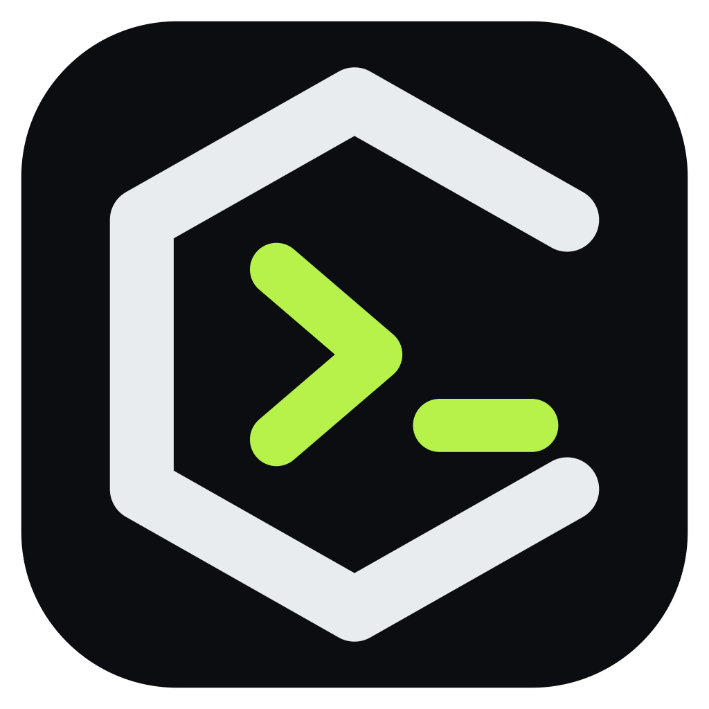

# Code Terminal



Criado por Diogo Costa Santos e publicado pela Código Central.

Um emulador de terminal moderno, rápido e rico em funcionalidades, escrito em Rust.

## 🎯 Objetivo

Um terminal que reúne o que hoje está espalhado em vários programas: o
desempenho de um terminal nativo com GPU, o multiplexer, o navegador, o
gerenciador SSH e a integração com agentes de IA. E que continue leve.

O lançamento público só acontece quando todas as linhas da tabela abaixo
estiverem verdes na coluna **Hoje**.

| Feature | Plano | Hoje |
|---|:---:|---|
| GPU, cores, tabs, busca, paleta, temas | ✅ | ✅ 18 temas embutidos |
| Conformidade VT (vim, htop, tmux) | ✅ | ✅ Emoji e CJK alinhados às colunas |
| Mouse para os programas | ✅ | ✅ |
| Splits / multiplexer | ✅ | ✅ Splits na tela e sessões persistentes (o shell sobrevive ao fechar o app) |
| Abas verticais e sidebar | ✅ | ✅ Branch, diretório, painéis, portas e status dos plugins |
| Anéis de notificação | ✅ | ✅ |
| Navegador | ✅ | ✅ Em janela própria, controlado pelo terminal |
| Plugins WASM | ✅ | ✅ O app carrega e roda plugins reais |
| IA e hooks de agentes | ✅ | ✅ |
| Imagens inline | ✅ | ✅ Protocolos kitty e iTerm2 |
| CLI e Socket API | ✅ | ✅ Controlam a tela de verdade |
| Gerenciador SSH | ✅ | ✅ Lista os hosts do `~/.ssh/config` e abre a conexão numa tab |
| Abrir em menos de 50 ms | ✅ | ✅ ~40 ms com o [modo servidor](docs/SERVER_MODE.md); a frio, ~150 ms (era de 0,15 a 1,7 s) |
| Usar menos de 30 MB | ✅ | ❌ 73 MB privados (era ~170 MB); com o modo servidor, cada janela extra custa ~4,5 MB; cada aba com 10 mil linhas de histórico, ~2 MB (era ~38 MB) |

Metas de desempenho: abrir em menos de 50 ms, latência de entrada abaixo de
5 ms, nativo em Windows, Linux e macOS.

## 🚀 Status

**Fase:** pré-lançamento (ainda não há versão pública)  
**Versão:** 0.1.0-alpha

## 🛠️ Stack

- **Linguagem**: Rust 1.85+
- **Rendering**: wgpu 24.0, winit 0.30, glyphon 0.8
- **PTY**: portable-pty 0.8
- **VT Parser**: vte 0.15
- **Async**: tokio 1.43
- **WASM**: wasmtime (para plugins)

## 📁 Estrutura

```
codeterminal/
├── src/           # Código fonte
│   ├── app/       # Estado da aplicação, event loop
│   ├── ui/        # Interface (window, tabs, splits)
│   ├── terminal/  # Emulação (grid, buffer, parser, pty)
│   ├── renderer/  # GPU rendering (wgpu, text, pipeline)
│   ├── plugin/    # Sistema de plugins WASM
│   ├── multiplexer/ # Modo tmux-like (sessões)
│   ├── pane/      # Sistema unificado de panes
│   ├── config/    # Configuração (TOML, themes, keybindings)
│   ├── ai/        # Integração com AI providers
│   ├── ssh/       # Gerenciador SSH
│   ├── browser/   # Webview integrado
│   ├── session/   # Persistência de sessões
│   ├── notification/ # Sistema de notificações
│   └── utils/     # Utilitários (logging, errors)
├── tests/         # Testes de integração
├── benches/       # Benchmarks
├── docs/          # Documentação
└── config/        # Configuração
```

## 🏗️ Arquitetura

### Visão Geral

O Code Terminal segue uma arquitetura modular multi-camadas:

```
┌─────────────────────────────────────────────────────────────────┐
│                           Application                            │
├─────────────────────────────────────────────────────────────────┤
│  WindowManager → Window → SplitTree → Pane → Tab → Terminal     │
├─────────────────────────────────────────────────────────────────┤
│  Plugin System (WASM Sandbox) | Multiplexer | AI Integration    │
├─────────────────────────────────────────────────────────────────┤
│  Renderer (wgpu) | Terminal (VT Parser) | Input Handling        │
├─────────────────────────────────────────────────────────────────┤
│  Platform Abstraction (Windows/Linux/macOS)                     │
└─────────────────────────────────────────────────────────────────┘
```

### Componentes Principais

| Componente | Descrição | Status |
|------------|-----------|--------|
| **UI** | WindowManager, SplitTree, Tabs | ✅ Implementado |
| **Terminal** | Grid, Buffer, Parser, PTY | ✅ Implementado |
| **Renderer** | GPU rendering com wgpu | ✅ Implementado |
| **Multiplexer** | Sessões tmux-like | ✅ Implementado |
| **Plugins** | Sistema WASM | ✅ Implementado |
| **AI** | Integração com providers | ✅ Implementado |
| **SSH** | Gerenciador de conexões | ✅ Implementado |
| **Browser** | Webview integrado | ✅ Implementado |

### Documentação da Arquitetura

Para mais detalhes sobre a arquitetura:

- **[ARCHITECTURE.md](docs/ARCHITECTURE.md)** - Visão geral da arquitetura, diagramas, fluxo de dados
- **[PANE_ID_ARCHITECTURE.md](docs/PANE_ID_ARCHITECTURE.md)** - Sistema de identificadores unificado
- **[SPLITS_SYSTEM.md](docs/SPLITS_SYSTEM.md)** - Sistema de splits (árvore binária)
- **[WINDOW_MANAGER.md](docs/WINDOW_MANAGER.md)** - Multi-window support, Factory pattern
- **[PLUGIN_API.md](docs/PLUGIN_API.md)** - API de plugins com 80+ host functions
- **[UI_WINDOW_IMPLEMENTATION.md](docs/UI_WINDOW_IMPLEMENTATION.md)** - Detalhes de implementação UI
- **[DEPLOYMENT.md](DEPLOYMENT.md)** - Build, instalação e validação por plataforma

### Sistema de IDs Unificado

O projeto usa um sistema unificado de identificadores:

```rust
// src/types.rs
pub type PaneId    = u64;  // Identifica painéis
pub type TabId     = u64;  // Identifica abas
pub type WindowId  = u64;  // Identifica janelas
pub type SessionId = u64;  // Identifica sessões
```

Veja [PANE_ID_ARCHITECTURE.md](docs/PANE_ID_ARCHITECTURE.md) para detalhes.

## 🏗️ Build

```bash
# Build de desenvolvimento
cargo build

# Build de release (otimizado)
cargo build --release

# Rodar
cargo run

# Testes
cargo test --all-features --all-targets

# Check rápido
cargo check
```

## 📝 Configuração

O arquivo de configuração está em `~/.config/code-terminal/config.toml`
(ou em `$CODE_TERMINAL_CONFIG_DIR/config.toml`, se a variável estiver definida):

```toml
[window]
width = 800
height = 600
opacity = 0.95

[font]
family = "JetBrains Mono"
size = 12.0

[keybindings]
new_tab = "Ctrl+Shift+T"
split_horizontal = "Ctrl+Shift+E"
split_vertical = "Ctrl+Shift+O"

[theme]
name = "dark"
```

### Copiar e colar texto

| Sistema | Copiar | Colar |
|---|---|---|
| macOS | `⌘C` | `⌘V` |
| Windows | `Ctrl+C` com texto selecionado, ou `Ctrl+Shift+C` | `Ctrl+V` na tela principal, ou `Ctrl+Shift+V` |
| Linux | `Ctrl+Shift+C` | `Ctrl+Shift+V` |

No Windows, sem seleção o programa recebe `Ctrl+C`. Na tela alternativa,
como a que o Vim usa por padrão, o programa também recebe `Ctrl+V`.
`Shift+Insert` também cola nos três sistemas. No Linux, o clique do meio cola
a seleção primária. Os atalhos de copiar e colar em `[keybindings]` ficam
disponíveis no terminal em qualquer plataforma.

## 📖 Documentação

### Documentação Técnica

- [Arquitetura](docs/ARCHITECTURE.md) - Visão geral da arquitetura
- [PaneId Unificado](docs/PANE_ID_ARCHITECTURE.md) - Sistema de IDs
- [Sistema de Splits](docs/SPLITS_SYSTEM.md) - Divisão de tela
- [Window Manager](docs/WINDOW_MANAGER.md) - Multi-window
- [Plugin API](docs/PLUGIN_API.md) - API de plugins (80+ funções)
- [UI Window Implementation](docs/UI_WINDOW_IMPLEMENTATION.md)
- [Deployment](DEPLOYMENT.md) - Build, instalação e validação por plataforma

### Features

- [Agentes de código](docs/AGENT_INTEGRATION.md) - Avisos, anéis, sidebar, CLI e hooks do Claude Code
- [Multiplexer](docs/MULTIPLEXER.md) - Modo tmux-like
- [Sessions](docs/SESSIONS.md) - Persistência de sessões
- [Image Protocol](docs/IMAGE_PROTOCOL.md) - Suporte a imagens
- [SSH Manager](docs/SSH_MANAGER.md) - Gerenciamento SSH
- [AI Integration](docs/AI_INTEGRATION.md) - Integração AI
- [Browser](docs/BROWSER.md) - Webview integrado

## 🤝 Contribuindo

1. Fork o projeto
2. Crie uma branch (`git checkout -b feature/nova-feature`)
3. Commit suas mudanças (`git commit -am 'feat: adiciona nova feature'`)
4. Push para a branch (`git push origin feature/nova-feature`)
5. Abra um Pull Request (no primeiro, diga que concorda com o [CLA](CLA.md))

Veja [docs/ARCHITECTURE.md](docs/ARCHITECTURE.md) e [DEPLOYMENT.md](DEPLOYMENT.md) para arquitetura, build e testes.

## 📜 Licença

Licenciado sob a [GNU GPL, versão 3 ou posterior](LICENSE).

- **Plugins:** pela [exceção para plugins](LICENSE-PLUGIN-EXCEPTION.md), um
  plugin WASM que usa só a Plugin API pública pode ter qualquer licença,
  inclusive fechada.
- **Contribuições:** pedem a concordância com o [CLA](CLA.md). Você continua
  dono do que escreveu e autoriza a Código Central a usar a contribuição.

---

**Code Terminal** - Terminal moderno para desenvolvedores
